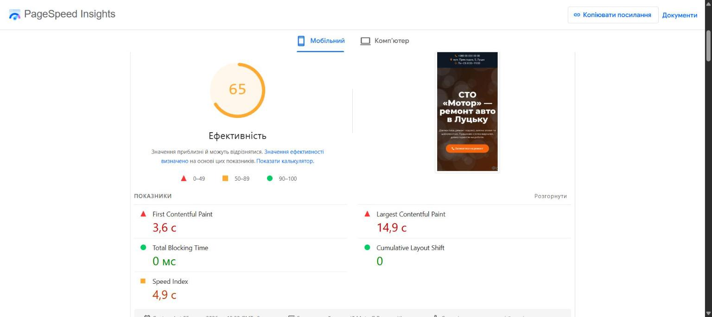
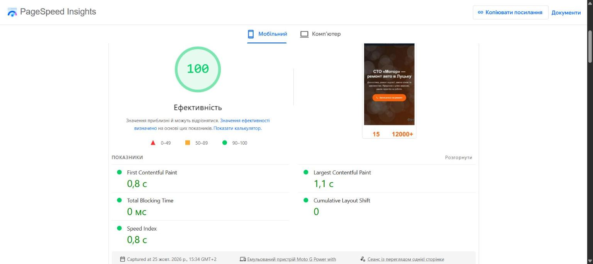

# Кейс: сторінка з Elementor → легкий HTML/CSS (PageSpeed 65 → 100)

Переробка сторінки вигаданого автосервісу «СТО «Мотор»» (Луцьк): той самий дизайн і текст, але без конструктора й важких фото.

🌐 **Кейс:** https://maksimka22.github.io/sto-speed-case/
· [Сторінка «до» (Elementor)](https://maksimka22.github.io/sto-speed-case/before/)
· [Сторінка «після»](https://maksimka22.github.io/sto-speed-case/after/)

## Результати (Google PageSpeed Insights, 25.10.2026)

| Показник | До, мобільний | Після, мобільний | До, комп’ютер | Після, комп’ютер |
|---|---|---|---|---|
| Ефективність | 65 | **100** | 81 | **100** |
| Largest Contentful Paint | 14,9 с | **1,1 с** | 3,2 с | **0,3 с** |
| First Contentful Paint | 3,6 с | **0,8 с** | 0,8 с | **0,2 с** |
| Speed Index | 4,9 с | **0,8 с** | 1,1 с | **0,3 с** |

Перше відкриття в Chrome (без кешу): **49 запитів і 2,7 МБ → 5 запитів і 188 КБ**, JavaScript-файлів **16 → 0**.

Звіти: [«до»](https://pagespeed.web.dev/analysis/https-maksimka22-github-io-sto-speed-case-before/l5n3f2osvt) · [«після»](https://pagespeed.web.dev/analysis/https-maksimka22-github-io-sto-speed-case-after/itbujezisg)




## Що зроблено

- Фото 4000×2667 по 4 МБ → 800/1600 px по 30–100 КБ, `srcset` під розмір екрана.
- Головне фото з CSS-фону → `` з `fetchpriority="high"` і `preload` (LCP 14,9 → 1,1 с).
- jQuery, Swiper, скрипти й анімації Elementor (16 JS) → жодного JavaScript: акордеон на `<details>`, галерея на CSS scroll-snap.
- 19 CSS-файлів і Google Fonts → один вбудований CSS, системні шрифти.
- Вбудована Google-карта → блок з адресою й посиланням на Google Maps.
- `loading="lazy"` і явні розміри для фото нижче першого екрана.
- Розмітка Schema.org `AutoRepair` для локального SEO.

## Структура

```
before/   статична копія сторінки, зібраної в Elementor 4.3.5 (WordPress 7)
after/    легка версія: один HTML-файл і оптимізовані фото
results/  скріншоти й цифри PageSpeed
tools/
  make-photos.ps1           генерує фото-заглушки: «з телефона» і оптимізовані
  build-elementor-page.php  збирає сторінку «до» в Elementor (фото, секції, віджети)
  mirror_before.py          робить статичну копію сторінки «до» для GitHub Pages
```

## Чесно про умови

Бізнес вигаданий, фото — згенеровані заглушки. Сторінку «до» зібрано в справжньому Elementor так, як це роблять власники сайтів, і обидві сторінки опубліковано на GitHub Pages, щоб заміряти їх в однакових умовах. Обидві закриті від індексації (`noindex`), тому оцінка «SEO» в PageSpeed занижена однаково.

Зроблено за допомогою Claude Code (AI-асистент). Стек: WordPress, Elementor, HTML, CSS, PHP, Python, PageSpeed Insights.
